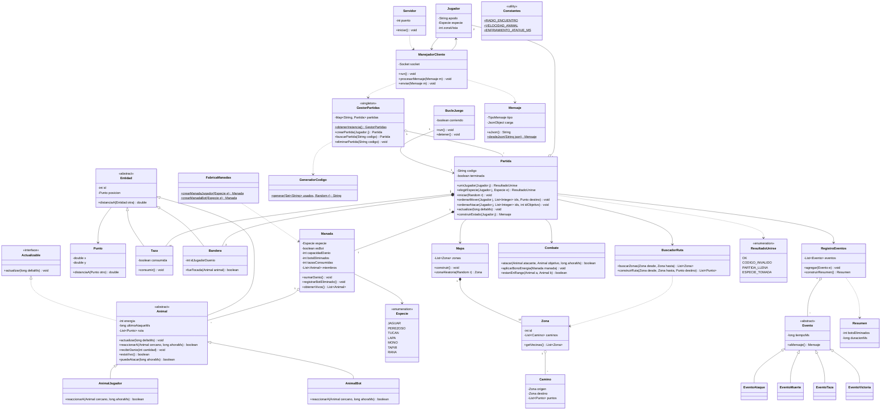

# Jungle Attack - Servidor - Especificación de Clases

## Paquete `util`

### Clase `Constantes`
Solo atributos `static final`, sin métodos.

**Atributos:**
- `PUERTO: int`
- `TOTAL_ZONAS: int` — 12
- `TOTAL_ESPECIES: int` — 7
- `TOTAL_TAZAS: int` — 10
- `ENERGIA_JUGADOR: int` — 20
- `ENERGIA_BOT: int` — 10
- `MIEMBROS_JUGADOR: int` — 10
- `MIEMBROS_BOT: int` — 4
- `DANIO_JUGADOR: int` — 2
- `DANIO_BOT: int` — 1
- `RADIO_ENCUENTRO: double`
- `VELOCIDAD_ANIMAL: double`
- `ENFRIAMIENTO_ATAQUE_MS: long` — 1000
- `MAX_ENERGIA_JUGADOR: int` — 20
- `LONGITUD_CODIGO: int` — 4
- `MS_POR_TICK: int`

---

## Paquete `modelo`

### Enum `Especie`
- `JAGUAR`, `PEREZOSO`, `TUCAN`, `LAPA`, `MONO`, `TAPIR`, `RANA`

### Clase `Punto`
**Atributos:**
- `x: double`
- `y: double`

**Métodos:**
- `distanciaA(Punto otro): double`
- `getX(): double`, `getY(): double`

### Interfaz `Actualizable`
**Métodos:**
- `actualizar(long deltaMs): void`

### Clase abstracta `Entidad`
**Atributos:**
- `id: int`
- `posicion: Punto`

**Métodos:**
- `distanciaA(Entidad otra): double`
- `getId(): int`
- `getPosicion(): Punto`
- `setPosicion(Punto p): void`

### Clase abstracta `Animal` (extiende `Entidad`, implementa `Actualizable`)
**Atributos:**
- `energia: int`
- `ultimoAtaqueMs: long`
- `manada: Manada`
- `ruta: List<Punto>`
- `zonaActual: int`

**Métodos:**
- `actualizar(long deltaMs): void` — avanza por la ruta a velocidad constante
- `reaccionarA(Animal cercano, long ahoraMs): boolean` — abstracto
- `recibirDanio(int cantidad): void`
- `estaVivo(): boolean`
- `puedeAtacar(long ahoraMs): boolean`
- `asignarRuta(List<Punto> ruta): void`
- `getManada(): Manada`

### Clase `AnimalJugador` (extiende `Animal`)
**Métodos:**
- `reaccionarA(Animal cercano, long ahoraMs): boolean` — no hace nada, el jugador ordena el ataque

### Clase `AnimalBot` (extiende `Animal`)
**Métodos:**
- `reaccionarA(Animal cercano, long ahoraMs): boolean` — ataca solo si el cercano es de un jugador

### Clase `Taza` (extiende `Entidad`)
**Atributos:**
- `consumida: boolean`

**Métodos:**
- `consumir(): void`
- `estaConsumida(): boolean`

### Clase `Bandera` (extiende `Entidad`)
**Atributos:**
- `idJugadorDuenio: int`

**Métodos:**
- `fueTocada(Animal animal): boolean`

### Clase `Manada`
**Atributos:**
- `especie: Especie`
- `esBot: boolean`
- `capacidadDanio: int`
- `botsEliminados: int`
- `tazasConsumidas: int`
- `miembros: List<Animal>`

**Métodos:**
- `agregarAnimal(Animal a): void`
- `sumarDanio(): void`
- `registrarBotEliminado(): void`
- `registrarTaza(): void`
- `obtenerVivos(): List<Animal>`
- `contarMuertos(): int`

### Clase `FabricaManadas`
**Métodos (estáticos):**
- `crearManadaJugador(Especie e): Manada` — patrón Factory
- `crearManadaBot(Especie e): Manada`

---

## Paquete `mapa`

### Clase `Zona`
**Atributos:**
- `id: int`
- `caminos: List<Camino>`

**Métodos:**
- `agregarCamino(Camino c): void`
- `getVecinas(): List<Zona>`

### Clase `Camino`
**Atributos:**
- `origen: Zona`
- `destino: Zona`
- `puntos: List<Punto>`

### Clase `Mapa`
**Atributos:**
- `zonas: List<Zona>`

**Métodos:**
- `construir(): void`
- `zonaAleatoria(Random r): Zona`
- `getZona(int id): Zona`

### Clase `BuscadorRuta`
**Métodos:**
- `buscarZonas(Zona desde, Zona hasta): List<Zona>` — BFS
- `construirRuta(Zona desde, Zona hasta, Punto destino): List<Punto>`

---

## Paquete `logica`

### Clase `Combate`
**Métodos:**
- `atacar(Animal atacante, Animal objetivo, long ahoraMs): boolean`
- `aplicarBonoEnergia(Manada manada): void`
- `estanEnRango(Animal a, Animal b): boolean`

---

## Paquete `eventos`

### Clase abstracta `Evento`
**Atributos:**
- `tiempoMs: long`

**Métodos:**
- `aMensaje(): Mensaje` — abstracto

**Subclases:** `EventoAtaque`, `EventoMuerte`, `EventoTaza`, `EventoVictoria`

### Clase `RegistroEventos`
**Atributos:**
- `eventos: List<Evento>`

**Métodos:**
- `agregar(Evento e): void`
- `obtenerNuevos(): List<Evento>`
- `construirResumen(): Resumen`

### Clase `Resumen`
**Atributos:**
- `botsEliminados: int`
- `animalesPerdidosA: int`, `animalesPerdidosB: int`
- `tazasA: int`, `tazasB: int`
- `duracionMs: long`

---

## Paquete `partida`

### Enum `ResultadoUnirse`
- `OK`
- `CODIGO_INVALIDO`
- `PARTIDA_LLENA`
- `ESPECIE_TOMADA`

### Clase `Jugador`
**Atributos:**
- `apodo: String`
- `especie: Especie`
- `zonaVista: int`
- `conexion: ManejadorCliente`

**Métodos:**
- `getApodo(): String`
- `setEspecie(Especie e): void`
- `setZonaVista(int id): void`

### Clase `GeneradorCodigo`
**Métodos (estáticos):**
- `generar(Set<String> usados, Random r): String`

### Clase `GestorPartidas` (patrón Singleton)
**Atributos:**
- `instancia: GestorPartidas` — estático
- `partidas: Map<String, Partida>`

**Métodos:**
- `obtenerInstancia(): GestorPartidas` — estático
- `crearPartida(Jugador j): Partida`
- `buscarPartida(String codigo): Partida` — null si no existe
- `eliminarPartida(String codigo): void`

### Clase `Partida`
**Atributos:**
- `codigo: String`
- `jugador1: Jugador`, `jugador2: Jugador`
- `mapa: Mapa`
- `manadas: List<Manada>`
- `tazas: List<Taza>`
- `banderas: List<Bandera>`
- `combate: Combate`
- `buscadorRuta: BuscadorRuta`
- `registro: RegistroEventos`
- `terminada: boolean`
- `inicioMs: long`

**Métodos:**
- `unirJugador(Jugador j): ResultadoUnirse`
- `elegirEspecie(Jugador j, Especie e): ResultadoUnirse`
- `iniciar(Random r): void`
- `ordenarMover(Jugador j, List<Integer> ids, Punto destino): void`
- `ordenarAtacar(Jugador j, List<Integer> ids, int idObjetivo): void`
- `cambiarZonaVista(Jugador j, int idZona): void`
- `actualizar(long deltaMs): void`
- `construirEstado(Jugador j): Mensaje` — solo zonas visibles
- `estaTerminada(): boolean`

### Clase `BucleJuego` (implementa `Runnable`)
**Atributos:**
- `partida: Partida`
- `corriendo: boolean`

**Métodos:**
- `run(): void`
- `detener(): void`

---

## Paquete `red`

### Enum `TipoMensaje`
- `CREAR_PARTIDA`, `UNIRSE_PARTIDA`, `ELEGIR_ANIMAL`, `MOVER_ANIMALES`, `ATACAR`, `VER_ZONA`
- `PARTIDA_CREADA`, `PARTIDA_UNIDA`, `ERROR`, `SELECCION_ANIMALES`, `PARTIDA_INICIADA`, `ACTUALIZACION_ESTADO`, `FIN_PARTIDA`

### Clase `Mensaje`
**Atributos:**
- `tipo: TipoMensaje`
- `carga: JsonObject`

**Métodos:**
- `aJson(): String`
- `desdeJson(String json): Mensaje` — estático

### Clase `Servidor`
**Atributos:**
- `puerto: int`
- `servidor: ServerSocket`

**Métodos:**
- `iniciar(): void`

### Clase `ManejadorCliente` (implementa `Runnable`)
**Atributos:**
- `socket: Socket`
- `jugador: Jugador`
- `partida: Partida`

**Métodos:**
- `run(): void`
- `procesarMensaje(Mensaje m): void`
- `enviar(Mensaje m): void`
- `cerrar(): void`

---

## Resumen de diseño

| Aspecto | Detalle |
|---|---|
| Static | `Constantes`, `GeneradorCodigo.generar`, `FabricaManadas.crear...`, `Mensaje.desdeJson`, `GestorPartidas.obtenerInstancia` |
| Herencia | `Entidad` → `Animal` → `AnimalJugador`/`AnimalBot`; `Entidad` → `Taza`/`Bandera`; `Evento` → 4 subclases |
| Interfaces | `Actualizable`, `Runnable` |
| Polimorfismo | `Animal.reaccionarA`, `Evento.aMensaje` |
| Patrones | Singleton (`GestorPartidas`), Factory (`FabricaManadas`) |
| Errores | Sin excepciones para el flujo: `ResultadoUnirse`, `boolean` y `null` |

---

## Diagrama UML

